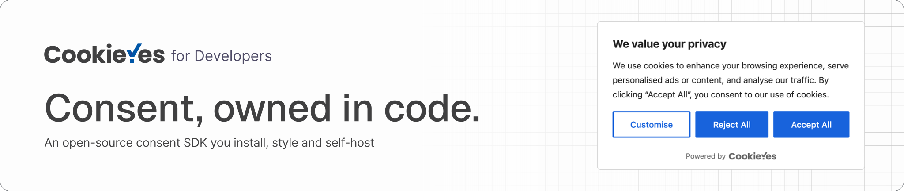

<p align="center">
  <picture>
    <source media="(prefers-color-scheme: dark)" srcset="https://raw.githubusercontent.com/cookieyes/cookieyes/main/.github/assets/banner-dark.svg">
    
  </picture>
</p>

<h1 align="center">@cookieyes/astro</h1>

<p align="center"><strong>The CookieYes consent banner for Astro 6 and 7.</strong></p>

<p align="center">One integration: the banner in the HTML, decided before first paint even on a static page, and kept across <code>&lt;ClientRouter /&gt;</code> navigations.</p>

<p align="center">
  <a href="https://www.npmjs.com/package/@cookieyes/astro"></a>
  <a href="https://www.npmjs.com/package/@cookieyes/astro"></a>
  <a href="https://github.com/cookieyes/cookieyes/actions/workflows/ci.yml"></a>
  <a href="./LICENSE"></a>
</p>

<p align="center">
  <a href="#quick-start">Quick start</a> ·
  <a href="#where-options-go">Options</a> ·
  <a href="#static-and-on-request-pages">Rendering</a> ·
  <a href="https://developers.cookieyes.com">Docs</a>
</p>

---

> **Not the CookieYes platform script.** This is the open-source SDK: you install it, you
> configure it in code, it needs no CookieYes account and it never talks to CookieYes servers.
> If you manage your banner in the CookieYes app, use the script tag the app gives you instead.

Requires Astro 6 or 7.

<!-- PEER-MATRIX:START — generated by apps/web/scripts/generate-peer-matrix-reference.mjs from
     matrix/matrix-results.json. Do not hand-edit between these markers; run
     `pnpm generate:peer-matrix-readme` instead. -->
| Astro | Node adapter | Verified | Build + typecheck | SSR (HTTP + prerendered page) | Behaviour (jsdom) |
|---|---|---|---|---|---|
| 6.0.0 (declared floor) | 10.0.2 | 2026-11-26 | pass | pass | pass |
| 7.4.13 | 11.1.14 | 2026-11-26 | pass | pass | pass |

Verified by installing the exact Astro versions above, building a real Astro app with the integration and the Node adapter, starting its server and asserting over HTTP the banner's HTML for first-time, returning and California visitors (the consent value the server read for the returning one, the order of the head tags and the stylesheet route), checking the app's prerendered page on disk, and running behaviour assertions in `jsdom`. Node 22, pnpm. See [rationale](https://github.com/cookieyes/cookieyes#compatibility) for why this stops short of a real browser.

**Not verified by this table:**
- Any Astro version outside the rows above.
- Any Astro adapter other than the Node adapter, and any host.
- npm/yarn as the install client.
- No real browser paint or hydration — SSR is asserted via server-rendered HTML/fetch only; client behaviour is asserted in jsdom, not a browser DOM (no Playwright).
- Node, package-manager and module-resolution dimensions are not yet varied within a framework: Next.js on Node 20, Vue on Node 20, Nuxt on Node 22, Svelte on Node 20, SvelteKit on Node 20 and 22, Astro on Node 22, all with pnpm and moduleResolution=bundler.
<!-- PEER-MATRIX:END -->

## Quick start

```bash
npx astro add @cookieyes/astro
```

That adds `cookieyes()` to `integrations` in `astro.config.mjs`. Give it your options:

```js
// astro.config.mjs
import cookieyes from "@cookieyes/astro";
import { defineConfig } from "astro/config";

export default defineConfig({
  integrations: [cookieyes({ mode: "cookie-only", regulation: "GDPR" })],
});
```

Then render the consent UI once, in your layout:

```astro
---
// src/layouts/Layout.astro
import { CookieYesRoot } from "@cookieyes/astro/components";
---
<html lang="en">
  <head><meta charset="utf-8" /></head>
  <body>
    <CookieYesRoot />
    <slot />
  </body>
</html>
```

That is the whole setup. `<CookieYesRoot />` renders the banner, the preferences dialog, the
recall button and, when a CCPA regulation can apply, the opt-out dialog. The integration adds the
stylesheet itself; there is nothing to import.

## Where options go

`cookieyes()` takes the same options as `initCookieYes` in every other CookieYes package, so a
configuration copies across unchanged. Called with no options, it uses `mode: "cookie-only"`.

Options that hold functions (integrations, `onConsentReady`, `onConsentUpdate`, `region.detect`)
go in `src/cookieyes.client.ts` instead, as its default export: the config reaches the server and
the browser as JSON, which drops functions. The integration finds the file by itself, merges it
over the config (the file wins per key, one level deep), and warns in development when it finds a
function in `astro.config.mjs`. Keep `categories` in `astro.config.mjs`: the head script that
decides first paint reads them there.

```ts
// src/cookieyes.client.ts
import { ga4 } from "@cookieyes/scripts";

export default { integrations: [ga4({ measurementId: "G-XXXXXXX" })] };
```

`networkBlocker` needs no registration step here. Put its `rules` in `astro.config.mjs`: the
integration registers the blocker before the SDK starts, and bundles it only then.

Two options only the integration reads:

| Option | Default | What it does |
|---|---|---|
| `googleConsentMode` | off | `true`, or the options of `googleConsentModeSnippet` from `@cookieyes/scripts`: adds Google Consent Mode's deny-by-default at the top of `<head>`, right after the charset and before any Google tag. |
| `stylesHref` | `/cookieyes/styles.css` | The path the stylesheet is served from. |

## Components

Import them from `@cookieyes/astro/components`. To choose your own set, or to add classes, give
`<CookieYesRoot />` a default slot:

```astro
<CookieYesRoot>
  <CookieBanner class="my-banner" classNames={{ acceptAll: "my-accept" }} />
  <CookiePreferences />
  <RecallButton />
</CookieYesRoot>
```

| Component | Props |
|---|---|
| `CookieBanner`, `CookiePreferences`, `CookieOptOut` | `class`, and `classNames` keyed by part, as in React |
| `RecallButton` | `class` |
| `ReloadNotice` | none |
| `GatedScript` | `id`, `src`, `category`: the script loads once the category is granted |
| `GatedFrame` | `src`, `category` and any iframe attribute; a `placeholder` slot replaces the default text |

The dialogs, the recall button and the notice are drawn in the browser when they open.

## Read and change consent

Use `@cookieyes/astro/client` in a `<script>` or an island. Each function waits for the runtime,
so it works even when it runs first:

```ts
import { getConsentCategory, onConsentChange, openPreferences } from "@cookieyes/astro/client";

if (await getConsentCategory("analytics")) loadAnalytics();
onConsentChange("change", ({ categories }) => console.log(categories), { category: "analytics" });
document.querySelector("#cookie-settings")?.addEventListener("click", openPreferences);
```

`getConsent`, `getConsentActions`, `getCookieYes` and `openOptOut` are there too, with
`registerStopHandler` (call it in `src/cookieyes.client.ts`, which runs before the SDK starts) and
`blockIframes` for embeds in HTML you do not render yourself. `youTubeEmbedUrl` is exported from
`@cookieyes/astro/components`, for a `<GatedFrame />` `src` built in frontmatter.

## Static and on-request pages

On a prerendered page the HTML is shared by every visitor, so nothing about one visitor is in it.
The banner is in the HTML, hidden, and a small inline script in `<head>` reads the consent cookie
before first paint: a first-time visitor sees the banner at once, a returning visitor never sees
it, and no request is made.

On a page rendered on request, the integration reads the request: the consent cookie, the Vercel
(`x-vercel-ip-country`, `x-vercel-ip-country-region`) and Cloudflare (`cf-ipcountry`) geo
headers, `Sec-GPC`, and in development the DevTools region override. A visitor who already chose
gets no banner markup, and with a `region` map a visitor the headers place in California gets the
CCPA banner from the first byte. The result is `Astro.locals.cookieyes`, typed without any edit to
`env.d.ts`; `getServerConsent(Astro)` and `getServerRegion(Astro)` from `@cookieyes/astro/server`
read it as `@cookieyes/nextjs/server` does.

With `<ClientRouter />` the banner, an open dialog and the recall button survive navigation, and
`<GatedScript />` and `<GatedFrame />` on the new page follow the current consent.

## Styles and CSP

The integration writes the banner's critical CSS inline in `<head>` and loads the full stylesheet
without blocking first paint, from a route it adds (a file in a static build; compressed and cached
for a year on a server). With Astro's `security.csp` turned on, the integration adds the hashes of
its inline head tags to the policy itself. Astro's CSP does not support `<ClientRouter />`. For a
policy you set yourself, `astro build` prints the hashes, and `CRITICAL_CSS_HASH` is exported:

```ts
import { CRITICAL_CSS_HASH } from "@cookieyes/astro";

const styleSrc = `style-src 'self' ${CRITICAL_CSS_HASH}`;
```

On a page rendered on request, a nonce your own middleware sets in `Astro.locals.cookieyes.nonce`,
or one already in the response's `Content-Security-Policy` header, is copied onto the head tags.

## License

Apache-2.0
