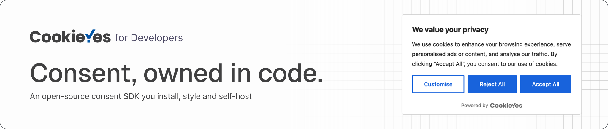

<p align="center">
  <picture>
    <source media="(prefers-color-scheme: dark)" srcset="https://raw.githubusercontent.com/cookieyes/cookieyes/main/.github/assets/banner-dark.svg">
    
  </picture>
</p>

<h1 align="center">@cookieyes/nuxt</h1>

<p align="center"><strong>The CookieYes consent banner for Nuxt 4.</strong></p>

<p align="center">One module: the banner in the server HTML, no flash for a returning visitor, and the components and composables of <code>@cookieyes/vue</code> available without imports.</p>

<p align="center">
  <a href="https://www.npmjs.com/package/@cookieyes/nuxt"></a>
  <a href="https://www.npmjs.com/package/@cookieyes/nuxt"></a>
  <a href="https://github.com/cookieyes/cookieyes/actions/workflows/ci.yml"></a>
  <a href="./LICENSE"></a>
</p>

<p align="center">
  <a href="#quick-start">Quick start</a> ·
  <a href="#where-options-go">Options</a> ·
  <a href="#server-rendering">Server rendering</a> ·
  <a href="https://developers.cookieyes.com">Docs</a>
</p>

---

> **Not the CookieYes platform script.** This is the open-source SDK: you install it, you
> configure it in code, it needs no CookieYes account and it never talks to CookieYes servers.
> If you manage your banner in the CookieYes app, use the script tag the app gives you instead.

Requires Nuxt 4.

<!-- PEER-MATRIX:START — generated by apps/web/scripts/generate-peer-matrix-reference.mjs from
     matrix/matrix-results.json. Do not hand-edit between these markers; run
     `pnpm generate:peer-matrix-readme` instead. -->
| Nuxt | Vue | Verified | Build + typecheck | SSR (HTML + cookie value) | Behaviour (jsdom) |
|---|---|---|---|---|---|
| 4.0.0 (declared floor) | 3.5.45 | 2026-11-16 | pass | pass | pass |
| 4.6.4 | 3.5.45 | 2026-11-16 | pass | pass | pass |

Verified by installing the exact Nuxt versions above (Vue is the version Nuxt resolved), building a real Nuxt app with the module, starting its server and asserting over HTTP the banner's HTML for first-time, returning and California visitors (and the consent value the server read for the returning one), then running behaviour assertions in Nuxt's test environment in `jsdom`. Node 22, pnpm. See [rationale](https://github.com/cookieyes/cookieyes#compatibility) for why this stops short of a real browser.

**Not verified by this table:**
- Any Nuxt version outside the rows above.
- npm/yarn as the install client.
- No real browser paint or hydration — SSR is asserted via server-rendered HTML/fetch only; client behaviour is asserted in jsdom, not a browser DOM (no Playwright).
- Node, package-manager and module-resolution dimensions are not yet varied within a framework: Next.js on Node 20, Vue on Node 20, Nuxt on Node 22, Svelte on Node 20, all with pnpm and moduleResolution=bundler.
<!-- PEER-MATRIX:END -->

## Quick start

```bash
npx nuxi module add @cookieyes/nuxt
```

That adds the module to `nuxt.config.ts`. Give it your options under `cookieyes`:

```ts
// nuxt.config.ts
export default defineNuxtConfig({
  modules: ["@cookieyes/nuxt"],
  cookieyes: { mode: "cookie-only", regulation: "GDPR" },
});
```

Then render the consent UI once, outside `<NuxtPage />` so it survives navigation:

```vue
<!-- app/app.vue -->
<template>
  <CookieYesRoot />
  <NuxtPage />
</template>
```

That is the whole setup. `<CookieYesRoot />` renders the banner, the preferences dialog, the
recall button and, when a CCPA regulation can apply, the opt-out dialog. The module adds the
stylesheet itself; there is nothing to import.

## Where options go

The `cookieyes` key takes the same options as `initCookieYes` in every other CookieYes package,
so a configuration copies across unchanged.

Options that hold functions (integrations, `onConsentReady`, `onConsentUpdate`, `region.detect`)
go under the same key in `app/app.config.ts` instead: `nuxt.config.ts` options travel as runtime
config, which is JSON and drops functions. The module merges the two files, and warns in
development when it finds a function in `nuxt.config.ts`. The integration helpers come from
`@cookieyes/scripts`, which the app installs itself.

`networkBlocker` needs no registration step here. Put its `rules` in `nuxt.config.ts`: the module
finds them there when it builds, registers the blocker before the SDK starts, and bundles it only
then.

```ts
// app/app.config.ts
import { ga4 } from "@cookieyes/scripts";

export default defineAppConfig({
  cookieyes: { integrations: [ga4({ measurementId: "G-XXXXXXX" })] },
});
```

Two options only the module reads, both in `nuxt.config.ts`:

| Option | Default | What it does |
|---|---|---|
| `googleConsentMode` | off | `true`, or the options of `googleConsentModeSnippet` from `@cookieyes/scripts`: adds Google Consent Mode's deny-by-default at the top of `<head>`, right after the charset and before any Google tag. |
| `stylesHref` | `/cookieyes/styles.css` | The path the module serves the full stylesheet from. |

## Read and change consent

Components and composables are auto-imported:

```vue
<script setup lang="ts">
const analytics = useConsentCategory("analytics");
const { showPreferences } = useConsentActions();
</script>

<template>
  <p v-if="analytics">Analytics is on.</p>
  <button type="button" @click="showPreferences">Cookie settings</button>
</template>
```

They are the components and composables of [`@cookieyes/vue`](../vue#readme), with the same
names and behaviour.

## Server rendering

On every server render the module reads the request: the consent cookie, the Vercel
(`x-vercel-ip-country`, `x-vercel-ip-country-region`) and Cloudflare (`cf-ipcountry`) geo
headers, and in development the DevTools region override. The result travels to the browser in
the Nuxt payload, so:

- a first-time visitor gets the banner in the server HTML;
- a visitor who already chose gets no banner markup at all, so nothing appears and vanishes;
- with a `region` map, a visitor the headers place in California gets the CCPA banner from the
  first byte.

Where the server reads the request, those headers are the only source of the region: the banner
and the consent runtime in the browser both use it, so what loads always follows the banner the
visitor sees. A `region.detect` in `app.config.ts` is used only where the server reads nothing
(below), once the page has loaded.

The browser's Global Privacy Control signal is applied after hydration, as in every CookieYes
package; it never changes which banner the server sends.

With `ssr: false`, or on a page built by `nuxt generate`, there is no request to read: the banner
is in every visitor's HTML and the browser hides it for a returning visitor after hydration. A
route with `swr`, `isr`, `cache` or `prerender` route rules behaves the same way: Nuxt serves one
HTML to every visitor there, so the module does not read the request, and one visitor's choice or
region never reaches another.

## Styles and CSP

The module writes the banner's critical CSS inline in `<head>` and loads the full stylesheet
without blocking first paint, from a route it serves (compressed, cached for a year). `nuxt
generate` writes that stylesheet as a static file. For a strict `style-src`, allow the inline
block by its hash:

```ts
import { CRITICAL_CSS_HASH } from "@cookieyes/nuxt";

const styleSrc = `style-src 'self' ${CRITICAL_CSS_HASH}`;
```

## License

Apache-2.0
