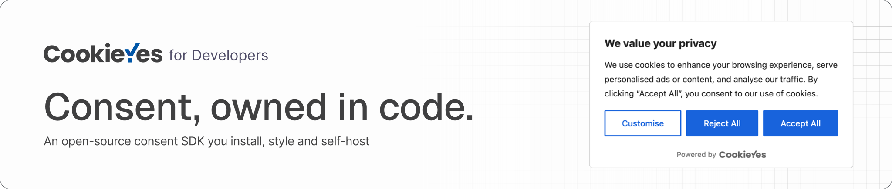

<p align="center">
  <picture>
    <source media="(prefers-color-scheme: dark)" srcset="https://raw.githubusercontent.com/cookieyes/cookieyes/main/.github/assets/banner-dark.svg">
    
  </picture>
</p>

<h1 align="center">@cookieyes/svelte</h1>

<p align="center"><strong>The CookieYes consent banner for Svelte 5.</strong></p>

<p align="center">A provider, components and hooks for GDPR and CCPA consent, with the same banner, dialogs and recall button as <code>@cookieyes/react</code>.</p>

<p align="center">
  <a href="https://www.npmjs.com/package/@cookieyes/svelte"></a>
  <a href="https://www.npmjs.com/package/@cookieyes/svelte"></a>
  <a href="https://github.com/cookieyes/cookieyes/actions/workflows/ci.yml"></a>
  <a href="./LICENSE"></a>
</p>

<p align="center">
  <a href="#quick-start">Quick start</a> ·
  <a href="#read-and-change-consent">Hooks</a> ·
  <a href="#styling-and-text">Styling</a> ·
  <a href="https://developers.cookieyes.com">Docs</a>
</p>

---

> **Not the CookieYes platform script.** This is the open-source SDK: you install it, you
> configure it in code, it needs no CookieYes account and it never talks to CookieYes servers.
> If you manage your banner in the CookieYes app, use the script tag the app gives you instead.

Requires Svelte 5.20 or later. Components are written in runes mode and ship as `.svelte` source,
so your Svelte toolchain (`@sveltejs/vite-plugin-svelte` or SvelteKit) compiles them.

<!-- PEER-MATRIX:START — generated by apps/web/scripts/generate-peer-matrix-reference.mjs from
     matrix/matrix-results.json. Do not hand-edit between these markers; run
     `pnpm generate:peer-matrix-readme` instead. -->
| Svelte | Vite | Vite plugin | Verified | Build + typecheck | SSR (HTML + cookie value) | Behaviour (jsdom) |
|---|---|---|---|---|---|---|
| 5.20.0 (declared floor) | 7.3.8 | 6.2.4 | 2026-11-20 | pass | pass | pass |
| 5.57.3 | 8.3.7 | 7.3.1 | 2026-11-20 | pass | pass | pass |

Verified by installing the exact Svelte versions above, building a real Vite app, rendering it on the server with `svelte/server` and asserting the banner's HTML (and a returning visitor's cookie value) is correct, then running behaviour and hydration assertions in `jsdom`. Node 20, pnpm. See [rationale](https://github.com/cookieyes/cookieyes#compatibility) for why this stops short of a real browser.

**Not verified by this table:**
- Any Svelte version outside the rows above.
- npm/yarn as the install client.
- No real browser paint or hydration — SSR is asserted via server-rendered HTML/fetch only; client behaviour is asserted in jsdom, not a browser DOM (no Playwright).
- Node, package-manager and module-resolution dimensions are not yet varied within a framework: Next.js on Node 20, Vue on Node 20, Nuxt on Node 22, Svelte on Node 20, SvelteKit on Node 20 and 22, Astro on Node 22, all with pnpm and moduleResolution=bundler.
- Server rendering of the Svelte rows is asserted on the Vite SSR build's render function, not a live server, so it does not prove a particular server framework forwards the Cookie header.
<!-- PEER-MATRIX:END -->

## Quick start

```bash
npm install @cookieyes/svelte
```

Put the config in a module of its own, so a server that renders per request reuses one object
instead of building a new runtime each time:

```ts
// src/lib/cookieyes.ts
import type { CookieYesConfig } from "@cookieyes/svelte";

export const config: CookieYesConfig = { mode: "cookie-only", regulation: "GDPR" };
```

Then a component that starts the SDK and renders the banner, the preferences dialog and the
recall button. Everything rendered inside it can use the hooks:

```svelte
<!-- src/lib/CookieYesRoot.svelte -->
<script lang="ts">
  import type { Snippet } from "svelte";
  import {
    CookieBanner,
    CookiePreferences,
    CookieYesProvider,
    RecallButton,
  } from "@cookieyes/svelte";
  import { config } from "./cookieyes";

  let { children }: { children?: Snippet } = $props();
</script>

<CookieYesProvider {config}>
  <CookieBanner />
  <CookiePreferences />
  <RecallButton />
  {@render children?.()}
</CookieYesProvider>
```

Wrap the app in it once, and load the stylesheet where the app starts:

```ts
// src/main.ts
import "@cookieyes/svelte/styles.css";
```

```svelte
<!-- src/App.svelte -->
<script lang="ts">
  import CookieYesRoot from "./lib/CookieYesRoot.svelte";
</script>

<CookieYesRoot>
  <!-- your page content -->
</CookieYesRoot>
```

`<CookieYesProvider>` takes the same `config` as `initCookieYes` in `@cookieyes/core` and
`@cookieyes/react`, so a configuration copies across unchanged. Add `<CookieOptOut />` next to the
banner under `regulation: "CCPA"`.

> **Do not leave out the stylesheet import.** Nothing checks at runtime that `styles.css`
> loaded. Without it the banner renders unstyled, and nothing warns.

## Read and change consent

The hooks are named like React's and return what React's return. They run while a component
initialises and throw if no `<CookieYesProvider>` is above the component. A hook that returns one
value, such as `useConsentCategory`, returns it as `{ current }`, because a function cannot return
a reactive value; the rest return an object whose fields stay reactive where Svelte tracks them.

```svelte
<script lang="ts">
  import { useConsentActions, useConsentCategory } from "@cookieyes/svelte";

  const analytics = useConsentCategory("analytics");
  const { showPreferences } = useConsentActions();
</script>

{#if analytics.current}<p>Analytics is on.</p>{/if}
<button type="button" onclick={showPreferences}>Cookie settings</button>
```

`useConsentCategory` reads the committed decision, the one in effect after Accept, Reject or
Save. `useConsentActions` only writes: `acceptAll`, `rejectAll`, `showPreferences` and the rest.
Read an object-shaped result, such as `useConsent()`, where Svelte tracks reads: in a template or
a `$derived`. Destructuring it reads the value once and loses reactivity; use
`const hasActed = $derived(consent.hasActed)` instead. Outside a component, `getCookieYes()`
returns the running runtime, for a store or a load function.

## Build your own

`Banner`, `Preferences` and `OptOut` hold the parts the stock components are made from, for
example `<Banner.Root>` and `<Banner.AcceptAll>`. Each part is also exported on its own as
`BannerRoot`, `BannerAcceptAll` and so on. A button part takes a `child` snippet to render your
own element, onto which you spread `props`:

```svelte
<Banner.AcceptAll>
  {#snippet child({ props })}
    <a {...props} href="#accepted">Accept</a>
  {/snippet}
</Banner.AcceptAll>
```

## Gate content on consent

`GatedScript` loads a script only after its category is granted. `GatedFrame` renders an embed
the same way, and shows its `placeholder` snippet until then.
`YouTubeEmbed` is the ready-made version for a YouTube video; see
[YouTube](https://developers.cookieyes.com/docs/svelte/integrations/youtube).

## Styling and text

The banner is the same markup as in every CookieYes package: the same `data-cy-part` names,
`--cy-*` variables, `theme` settings and translations. A stylesheet written for the React banner
restyles this one unchanged. `class` and `style` go to the banner card; `classNames` and `styles`
target one part by name. `styles` takes camelCase property names or custom properties.

## License

Apache-2.0
