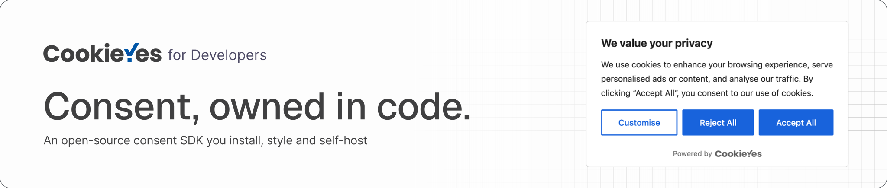

<p align="center">
  <picture>
    <source media="(prefers-color-scheme: dark)" srcset="https://raw.githubusercontent.com/cookieyes/cookieyes/main/.github/assets/banner-dark.svg">
    
  </picture>
</p>

<h1 align="center">@cookieyes/sveltekit</h1>

<p align="center"><strong>The CookieYes consent banner for SvelteKit.</strong></p>

<p align="center">A handle, a load function and a root component: the banner in the server HTML, no flash for a returning visitor, and the components and hooks of <code>@cookieyes/svelte</code> available from one import.</p>

<p align="center">
  <a href="https://www.npmjs.com/package/@cookieyes/sveltekit"></a>
  <a href="https://www.npmjs.com/package/@cookieyes/sveltekit"></a>
  <a href="https://github.com/cookieyes/cookieyes/actions/workflows/ci.yml"></a>
  <a href="./LICENSE"></a>
</p>

<p align="center">
  <a href="#quick-start">Quick start</a> ·
  <a href="#options">Options</a> ·
  <a href="#server-rendering">Server rendering</a> ·
  <a href="#styles-and-csp">CSP</a> ·
  <a href="https://developers.cookieyes.com">Docs</a>
</p>

---

> **Not the CookieYes platform script.** This is the open-source SDK: you install it, you
> configure it in code, it needs no CookieYes account and it never talks to CookieYes servers.
> If you manage your banner in the CookieYes app, use the script tag the app gives you instead.

Requires SvelteKit 2.62 or later (SvelteKit 3 is supported) and Svelte 5.20 or later.

<!-- PEER-MATRIX:START — generated by apps/web/scripts/generate-peer-matrix-reference.mjs from
     matrix/matrix-results.json. Do not hand-edit between these markers; run
     `pnpm generate:peer-matrix-readme` instead. -->
| SvelteKit | Svelte | Vite | Vite plugin | Verified | Build + typecheck | SSR (HTTP + static build) | Behaviour (jsdom) |
|---|---|---|---|---|---|---|---|
| 2.62.0 (declared floor) | 5.20.0 | 7.3.8 | 6.2.4 | 2026-11-20 | pass | pass | pass |
| 2.70.4 | 5.57.3 | 8.3.7 | 7.3.1 | 2026-11-20 | pass | pass | pass |
| 3.2.0 | 5.57.3 | 8.3.7 | 7.3.1 | 2026-11-20 | pass | pass | pass |

Verified by installing the exact SvelteKit and Svelte versions above, building a real SvelteKit app with the package and its adapter-node server, starting it and asserting over HTTP the banner's HTML for first-time, returning and California visitors (the consent value the server read for the returning one, the order of the head tags and the stylesheet route), then building the same app once with adapter-static and checking its prerendered page and stylesheet file, and running behaviour assertions in `jsdom`. Node 20 for SvelteKit 2 and Node 22 for SvelteKit 3, pnpm. See [rationale](https://github.com/cookieyes/cookieyes#compatibility) for why this stops short of a real browser.

**Not verified by this table:**
- Any SvelteKit or Svelte version outside the rows above.
- Any SvelteKit adapter other than adapter-node and adapter-static, and any host.
- npm/yarn as the install client.
- No real browser paint or hydration — SSR is asserted via server-rendered HTML/fetch only; client behaviour is asserted in jsdom, not a browser DOM (no Playwright).
- Node, package-manager and module-resolution dimensions are not yet varied within a framework: Next.js on Node 20, Vue on Node 20, Nuxt on Node 22, Svelte on Node 20, SvelteKit on Node 20 and 22, Astro on Node 22, all with pnpm and moduleResolution=bundler.
<!-- PEER-MATRIX:END -->

## Quick start

```bash
npm install @cookieyes/sveltekit
```

Put the config in a module of its own. The server and the browser both import it, so they run the
same options. The examples import it by relative path, which works on SvelteKit 2 and 3 (SvelteKit
3 replaced the `$lib` alias with `#lib`):

```ts
// src/lib/cookieyes.ts
import type { CookieYesConfig } from "@cookieyes/sveltekit";

export const config: CookieYesConfig = { mode: "cookie-only", regulation: "GDPR" };
```

Add the handle, which reads each request once:

```ts
// src/hooks.server.ts
import { cookieyesHandle } from "@cookieyes/sveltekit";
import { config } from "./lib/cookieyes";

export const handle = cookieyesHandle(config);
```

Pass what it read to the page from the root layout's server `load`:

```ts
// src/routes/+layout.server.ts
import { loadConsent } from "@cookieyes/sveltekit";

export const load = loadConsent;
```

Render the consent UI once in the root layout, with the page inside it:

```svelte
<!-- src/routes/+layout.svelte -->
<script lang="ts">
  import { CookieYesRoot } from "@cookieyes/sveltekit";
  import { config } from "../lib/cookieyes";

  let { data, children } = $props();
</script>

<CookieYesRoot {config} state={data.consent}>
  {@render children()}
</CookieYesRoot>
```

Serve the stylesheet the handle links to:

```ts
// src/routes/cookieyes/styles.css/+server.ts
export { GET } from "@cookieyes/sveltekit/styles-route";
```

Finally let TypeScript know about `event.locals.cookieyes`:

```ts
// src/app.d.ts
/// <reference types="@cookieyes/sveltekit" />
```

`<CookieYesRoot>` renders the banner, the preferences dialog, the recall button and, when a CCPA
regulation can apply, the opt-out dialog, and then your page. Pass a `ui` snippet to replace those
four with your own consent UI; the page is still rendered inside the same provider, so the hooks
work in it. There is no stylesheet to import: the handle writes the critical CSS into the head and
loads the rest from the route above.

## Options

`cookieyesHandle` takes the same options as `initCookieYes` in every other CookieYes package, so a
configuration copies across unchanged, plus two that only the handle reads:

| Option | Default | What it does |
|---|---|---|
| `googleConsentMode` | off | `true`, or the options of `googleConsentModeSnippet` from `@cookieyes/scripts`: adds Google Consent Mode's deny-by-default at the top of `<head>`, right after the charset and before any Google tag. |
| `stylesHref` | `/cookieyes/styles.css` | The path the stylesheet route is mounted at. |

`<CookieYesRoot>` takes the full config as its `config` prop, functions included. It never travels
in `data`: SvelteKit serialises what a server `load` returns, so `loadConsent` hands over only
plain data (what the server read), and the config, which may hold integrations and callbacks,
comes from the shared module on each side.

The handle composes with your own: `sequence(cookieyesHandle(config), yourHandle)`, and a
`transformPageChunk` of yours still runs.

## Read and change consent

The components and hooks of [`@cookieyes/svelte`](../svelte#readme) are exported from this package
too, with the same names and behaviour, so an app that installed only this package can reach them:

```svelte
<script lang="ts">
  import { useConsentActions, useConsentCategory } from "@cookieyes/sveltekit";

  const analytics = useConsentCategory("analytics");
  const { showPreferences } = useConsentActions();
</script>

{#if analytics.current}<p>Analytics is on.</p>{/if}
<button type="button" onclick={showPreferences}>Cookie settings</button>
```

## Server rendering

On every request the handle reads the consent cookie, the Vercel (`x-vercel-ip-country`,
`x-vercel-ip-country-region`) and Cloudflare (`cf-ipcountry`) geo headers, `Sec-GPC`, and in
development the DevTools region override, into `event.locals.cookieyes`. `loadConsent` hands the
rest to the browser in `data.consent`, so:

- a first-time visitor gets the banner in the server HTML;
- a visitor who already chose gets no banner markup at all, so nothing appears and vanishes;
- with a `region` map, a visitor the headers place in California gets the CCPA banner from the
  first byte.

Where the server reads the request, those headers are the only source of the region: the banner
and the consent runtime in the browser both use it, so what loads always follows the banner the
visitor sees. `Sec-GPC` stays on the server. The browser's Global Privacy Control signal is applied
after hydration, as in every CookieYes package; it never changes which banner the server sends.

A prerendered page reads nothing from the request: it is built once for every visitor, so the
banner is in the HTML for everyone and the browser decides after hydration. A route with
`ssr = false` serves a shell and mounts on the client, where `data.consent` arrives from the
server's data request. In a build with no server at all, such as `adapter-static`, leave out
`+layout.server.ts` and render `<CookieYesRoot {config}>` without `state`; add
`export const prerender = true;` to the stylesheet route so it is written as a file.

## Styles and CSP

The handle writes the banner's critical CSS inline in `<head>` and loads the full stylesheet
without blocking first paint, from the route above (compressed, cached for a year). For a strict
`style-src`, add the hash of that inline block. It is the SHA-256 of the package's `critical.css`,
and the package also exports it as `CRITICAL_CSS_HASH`; `svelte.config.js` runs in Node, which
cannot load the package's entry (it holds `.svelte` files), so compute it from the file there:

SvelteKit 2 (`svelte.config.js`):

```js
// svelte.config.js
import { createHash } from "node:crypto";
import { readFileSync } from "node:fs";
import { createRequire } from "node:module";

const critical = readFileSync(
  createRequire(import.meta.url).resolve("@cookieyes/sveltekit/critical.css"),
  "utf8",
);
const criticalHash = `'sha256-${createHash("sha256").update(critical, "utf8").digest("base64")}'`;

export default {
  kit: {
    csp: { directives: { "style-src": ["self", criticalHash] } },
  },
};
```

SvelteKit 3 takes the same `csp` object as a top-level key of the `sveltekit({ ... })` call in
`vite.config.ts`, with the same `criticalHash` computed there:

```ts
// vite.config.ts
export default defineConfig({
  plugins: [sveltekit({ csp: { directives: { "style-src": ["self", criticalHash] } } })],
});
```

The handle never rewrites a CSP header and puts no nonce on the `<style>`: SvelteKit admits
styles by hash, not by nonce. The Google Consent Mode `<script>`, when you ask for it, takes the
nonce SvelteKit put on its own scripts, so a `script-src` with a nonce admits it. A prerendered
page carries its policy in a `<meta>` tag that comes after these tags, so there the policy that
matters is the one your host sends as a header.

## License

Apache-2.0
