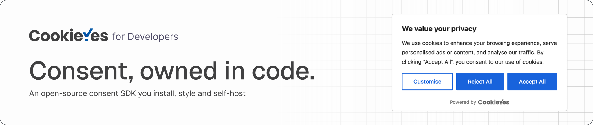

<p align="center">
  <picture>
    <source media="(prefers-color-scheme: dark)" srcset="https://raw.githubusercontent.com/cookieyes/cookieyes/main/.github/assets/banner-dark.svg">
    
  </picture>
</p>

<h1 align="center">@cookieyes/vue</h1>

<p align="center"><strong>The CookieYes consent banner for Vue 3.</strong></p>

<p align="center">A plugin, components and composables for GDPR and CCPA consent, with the same banner, dialogs and recall button as <code>@cookieyes/react</code>.</p>

<p align="center">
  <a href="https://www.npmjs.com/package/@cookieyes/vue"></a>
  <a href="https://www.npmjs.com/package/@cookieyes/vue"></a>
  <a href="https://github.com/cookieyes/cookieyes/actions/workflows/ci.yml"></a>
  <a href="./LICENSE"></a>
</p>

<p align="center">
  <a href="#quick-start">Quick start</a> ·
  <a href="#read-and-change-consent">Composables</a> ·
  <a href="#styling-and-text">Styling</a> ·
  <a href="https://developers.cookieyes.com">Docs</a>
</p>

---

> **Not the CookieYes platform script.** This is the open-source SDK: you install it, you
> configure it in code, it needs no CookieYes account and it never talks to CookieYes servers.
> If you manage your banner in the CookieYes app, use the script tag the app gives you instead.

Requires Vue 3.5 or later.

<!-- PEER-MATRIX:START — generated by apps/web/scripts/generate-peer-matrix-reference.mjs from
     matrix/matrix-results.json. Do not hand-edit between these markers; run
     `pnpm generate:peer-matrix-readme` instead. -->
| Vue | Verified | Build + typecheck | SSR (HTML + cookie value) | Behaviour (jsdom) |
|---|---|---|---|---|
| 3.5.0 (declared floor) | 2026-11-11 | pass | pass | pass |
| 3.5.45 | 2026-11-11 | pass | pass | pass |

Verified by installing the exact Vue versions above, building a real Vite app, rendering it on the server with `vue/server-renderer` and asserting the banner's HTML (and a returning visitor's cookie value) is correct, then running behaviour and hydration assertions in `jsdom`. Node 20, pnpm. See [rationale](https://github.com/cookieyes/cookieyes#compatibility) for why this stops short of a real browser.

**Not verified by this table:**
- Any Vue version outside the rows above.
- npm/yarn as the install client.
- No real browser paint or hydration — SSR is asserted via server-rendered HTML/fetch only; client behaviour is asserted in jsdom, not a browser DOM (no Playwright).
- Node, package-manager and module-resolution dimensions are not yet varied within a framework: Next.js on Node 20, Vue on Node 20, Nuxt on Node 22, Svelte on Node 20, SvelteKit on Node 20 and 22, all with pnpm and moduleResolution=bundler.
- Server rendering of the Vue rows is asserted on the Vite SSR build's render function, not a live server, so it does not prove a particular server framework forwards the Cookie header.
<!-- PEER-MATRIX:END -->

## Quick start

```bash
npm install @cookieyes/vue
```

Three files wire it in. First, a setup function that starts the SDK and loads the stylesheet:

```ts
// src/consent-manager.ts
import type { App } from "vue";
import { CookieYes, type CookieYesConfig } from "@cookieyes/vue";
import "@cookieyes/vue/styles.css";

const config: CookieYesConfig = { mode: "cookie-only", regulation: "GDPR" };

export function setupConsent(app: App): void {
  app.use(CookieYes, config);
}
```

Call it before the app mounts:

```ts
// src/main.ts
import { createApp } from "vue";
import App from "./App.vue";
import { setupConsent } from "./consent-manager";

const app = createApp(App);
setupConsent(app);
app.mount("#app");
```

Then a component that renders the banner, the preferences dialog and the recall button:

```vue
<!-- src/components/CookieYesRoot.vue -->
<script setup lang="ts">
import { CookieBanner, CookiePreferences, RecallButton } from "@cookieyes/vue";
</script>

<template>
  <CookieBanner />
  <CookiePreferences />
  <RecallButton />
</template>
```

Render it once, before the page content:

```vue
<!-- src/App.vue -->
<script setup lang="ts">
import CookieYesRoot from "./components/CookieYesRoot.vue";
</script>

<template>
  <CookieYesRoot />
  <RouterView />
</template>
```

`app.use(CookieYes, config)` takes the same configuration as `initCookieYes` in
`@cookieyes/core` and `@cookieyes/react`, so a configuration copies across unchanged. Add
`<CookieOptOut />` next to the banner under `regulation: "CCPA"`.

> **Do not leave out the stylesheet import.** Nothing checks at runtime that `styles.css`
> loaded. Without it the banner renders unstyled, and nothing warns.

## Read and change consent

The composables are named like React's hooks and return refs, so they stay reactive in templates
and in `computed` and `watch`. They throw if `app.use(CookieYes, config)` has not run.

```vue
<script setup lang="ts">
import { useConsentActions, useConsentCategory } from "@cookieyes/vue";

const analytics = useConsentCategory("analytics");
const { showPreferences } = useConsentActions();
</script>

<template>
  <p v-if="analytics">Analytics is on.</p>
  <button type="button" @click="showPreferences">Cookie settings</button>
</template>
```

`useConsentCategory` reads the committed decision, the one in effect after Accept, Reject or
Save. `useConsentActions` only writes: `acceptAll`, `rejectAll`, `showPreferences` and the rest.
Outside a component, `getCookieYes()` returns the running runtime, for a store or a router
guard.

## Gate content on consent

`GatedScript` loads a script only after its category is granted. `GatedFrame` renders an embed
the same way, and shows its `placeholder` slot until then.

## Styling and text

The banner is the same markup as in every CookieYes package: the same `data-cy-part` names,
`--cy-*` variables, `theme` settings and translations. A stylesheet written for the React banner
restyles this one unchanged. The package ships compiled JavaScript, types and CSS only, so a
Vue project needs no bundler setting for it.

## License

Apache-2.0
